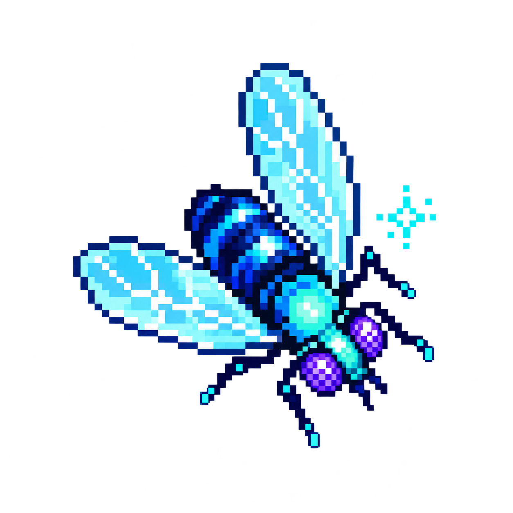
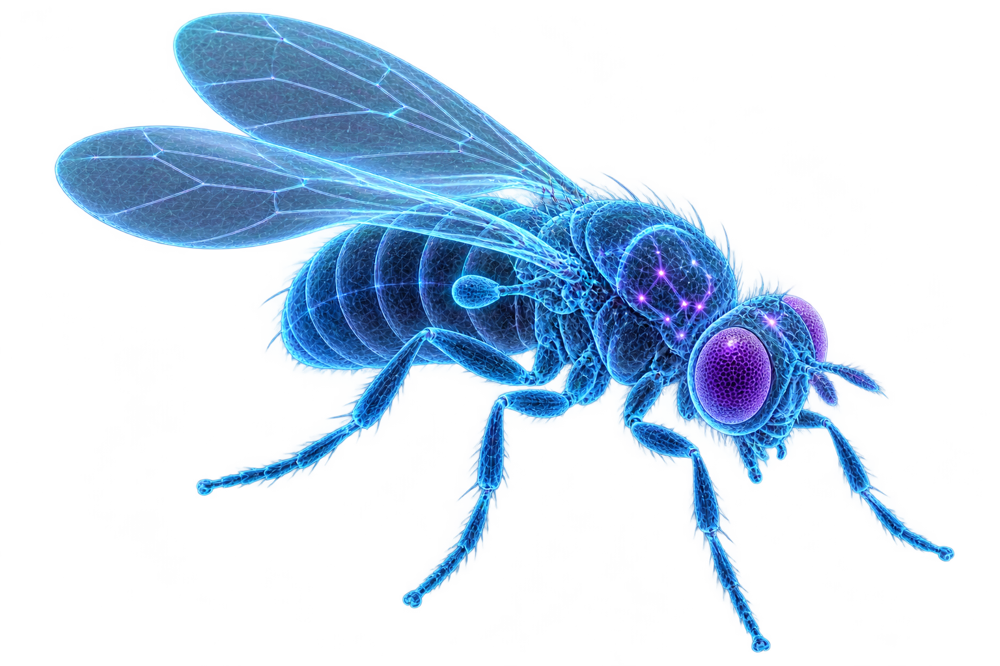
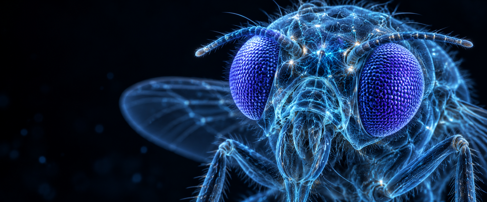

<p align="center">
  
</p>

<h1 align="center">Quantum Fly</h1>
<p align="center"><strong>One fly. Four possible moves. A phase-sensitive decision loop.</strong></p>
<p align="center">A local laboratory for synthetic neural activity, quantum-circuit simulation, and embodied behavior.</p>


Quantum Fly gives a tiny fly-inspired body an inspectable decision system. It receives an odor field and other sensory signals, runs them through a small spiking controller, encodes part of that activity into a two-qubit circuit, and samples one move. The body changes its position. Its next sensory input changes with it.

The interesting question is simple: **if you change a phase inside the decision circuit, what changes outside the fly?**

You can follow the full chain: sensory readings, individual spike events, gate parameters, measurement probabilities, the selected action, and the resulting path. Freeze the inputs to study interference. Erase phase information to study the channel. Fork a seed to watch two paths separate.

**Version 0.1.0 runs entirely on a classical computer.** The 48 neural units are an original synthetic model; the two qubits are simulated mathematically. The fly illustrations are original stylized artwork. This project does not import a biological connectome or record a living fly.

| Component | Implementation |
|---|---|
| Body | One procedural fly moving in a 720 × 440 world |
| Input | 12 normalized channels, including two odor probes |
| Neural controller | 48 discrete-time leaky integrate-and-fire units |
| Functional groups | 16 sensory, 16 recurrent, 16 motor |
| Circuit | 2 qubits, 4 complex amplitudes, 4 × 4 density matrix |
| Gates | RY, CX, RZ, optional partial dephasing, H, RY |
| Action readout | Advance, turn left, turn right, pause |
| Observation | 14 laboratory views and PNG captures |
| Reproducibility | Seeded sampling and resumable JSON checkpoints |
| Runtime | Offline browser demo; Node.js for tests and experiments |

[Start](docs/START.md) · [Methods](docs/METHODS.md) · [Circuit mathematics](docs/QUANTUM.md) · [Experiments](experiments/README.md) · [Results](experiments/RESULTS.md) · [Screenshot gallery](docs/GALLERY.md) · [Upload to GitHub](GITHUB-UPLOAD.md)

## Open the laboratory

**Quickest:** download the repository, extract it, and open **[Quantum-Fly.html](Quantum-Fly.html)** in a modern desktop browser. That file embeds all code and artwork. It needs no account, API key, package installation, or network connection.

On Windows, [Start-Quantum-Fly.bat](Start-Quantum-Fly.bat) opens the same file.

For the modular source, use Node.js 20 or newer:

```sh
npm start
```

Then open `http://127.0.0.1:4173`. Or use Python 3.10 or newer:

```sh
python start_quantum_fly.py
```

The source viewer and standalone viewer use the same renderer and simulation. The initial screen is seed 41 after 640 calculated ticks. Play advances the loop; Step advances one tick. Reset runs the current settings from the beginning. Reference and fork views are intentionally fixed demonstrations at seed 41, tick 640.

## The fly, up close


The wireframe body is a visual identity for the experiment. Its glowing lines do not represent measured synapses. The arena uses a separate procedural body glyph whose heading and position come from the simulation.



[Art provenance and prompts](assets/PROVENANCE.md) explain which images are illustrations and which are software captures.

## The loop

1. Two odor probes sample the environment beside the body. Other channels encode light, wall proximity, movement, energy, heading, and a clock.
2. The controller updates membrane potentials, emits spikes, applies refractory resets, and maintains smoothed activity.
3. A declared hand-written encoder maps sensor contrast and group activity into rotation angles.
4. A fresh two-qubit state is prepared, evolved through the circuit, optionally dephased, and read out.
5. One classical pseudorandom number selects an action from the four probabilities.
6. The body moves, hits boundaries or obstacles, consumes energy, and senses again.

The circuit is reinitialized at every tick. Memory lives in the recurrent controller and body state; there is no persistent quantum register between decisions. No parameters are trained in this release.

## Inspect the synthetic controller


The network panel displays the actual seeded wiring and current smoothed spike activity. The three rings correspond to functional groups chosen for this model. Positive and negative connections are synthetic weights; the placement is a schematic layout.


The raster shows binary spike events from the last 180 ticks. It is generated from the running controller, not a random decorative texture. A tick is a model update, not a calibrated biological millisecond.


[Neural model](docs/NEURAL.md) · [Sensors](docs/SENSORS.md) · [World and movement](docs/WORLD.md)

## The quantum decision interface


The simulator uses basis order `|q0 q1⟩ = |00⟩, |01⟩, |10⟩, |11⟩`. Qubit 0 is the most significant bit. Starting from `|00⟩`, the circuit applies:

```text
RY(theta0) on q0
RY(theta1) on q1
CX q0 -> q1
RZ(phi) on q0
partial dephasing on both qubits
H on q0
RY(readout) on q1
standard-basis measurement
```

These are implemented operations on complex vectors and density matrices. `RZ` changes relative phase without changing the immediate basis populations. The final gates make that phase relevant to the measurement probabilities. This is quantum-circuit mathematics on a classical CPU, not a claim about quantum processes in an insect.


| Basis outcome | Body action |
|---|---|
| `00` | Advance |
| `01` | Turn left and move slowly |
| `10` | Turn right and move slowly |
| `11` | Pause |

The action assignment is a software convention. A standard-basis measurement yields a classical outcome; the body takes one move. It does not execute all four actions simultaneously.

## Change only phase


The phase workbench freezes the other encoder parameters and calculates 65 values from −π to +π. Every curve is an exact output probability of the same small circuit. This isolates a circuit effect from the changing sensory history of a moving fly.

## Erase the interference


The dephasing control applies a defined channel before the final gates. Gamma 0 retains the state. Gamma 1 removes off-diagonal terms in the computational basis. Intermediate values partially suppress them independently on each qubit. The right-hand plot shows `Tr(rho²)`, the purity of the calculated output density matrix.

At full dephasing, this circuit's output probabilities become independent of the encoded phase. A test verifies that result. Gamma is a dimensionless channel parameter, not a measured noise rate from hardware or biology.

[Noise channel](docs/DEPHASING.md) · [Fixed-input experiments](experiments/phase-sweep.json)

## Put the decision back into a body


The arena contains an odor source, a plume, two obstacles, and boundary collisions. It deliberately stays small enough that you can inspect every input and intervention. The collision response and movement parameters are declared rules, not biomechanical measurements.


The phase fork starts two runs with the same wiring, body, seed, world, and uniform draw sequence. Only the phase offset differs. Different action probabilities can map the same draw to different moves. After those moves, the two sensory histories diverge.

## Compare against a declared reference


The classical reference uses a small softmax policy over sensory contrast, wall proximity, energy, and motor activity. It shares the same world and sampler. Full dephasing provides a separate circuit intervention; it is not interchangeable with the classical reference.

The bundled ten-seed batch contains 30 runs of 640 ticks. In that batch, the classical reference reaches the source in **10/10 runs**, while both circuit policies reach it in **0/10**. The purpose of the circuit policies is to expose phase-sensitive decisions. The reference is more effective at navigation under these parameters. These results do not establish quantum advantage.

[Raw metrics](data/matched-runs.json) · [Generated results](experiments/RESULTS.md) · [Comparison design](docs/BASELINE.md)

## Replay a decision exactly


Export a JSON checkpoint with the body, neural state, wiring, configuration, tick, and random-stream state. Importing it resumes the next calculated decision. The checkpoint contains state, not the entire historical raster. The resume test checks 50 subsequent frames against an uninterrupted run.

```sh
npm test
npm run experiments
npm run build
npm run check
```

These commands need only Node.js. To regenerate PNG captures, install the optional native Canvas package first:

```sh
npm install --no-save @napi-rs/canvas@0.1.100
npm run screenshots
```

The images in this repository were captured directly from the shared Canvas renderer. They are software-rendered figures, not claims of biological recordings or screenshots from a quantum processor.

## Another view of the specimen




## Repository guide

| Path | Contents |
|---|---|
| `src/core/` | Seeded randomness, world, sensors, LIF network, policy, replay |
| `src/quantum/` | Complex arithmetic, gates, density evolution, dephasing, sampling |
| `src/lab/` | Summaries, fixed sweeps, reference runs |
| `src/view/` | Shared Canvas renderer and browser controls |
| `assets/art/` | Original holographic fly and macro portrait |
| `assets/brand/` | Original pixel fly logo |
| `assets/screenshots/` | Fourteen 1600 × 1000 observation captures |
| `experiments/` | Run definitions, generated results, reproduction notes |
| `data/` | Raw phase, dephasing, and matched-policy results |
| `docs/` | Methods, equations, design choices, limits, and development notes |
| `examples/` | A replay checkpoint and an optional Qiskit cross-check |
| `tests/` | Model invariants, interference, interventions, and exact replay |
| `scripts/` | Local serving, bundling, experiments, capture, and validation |

## Scientific context

The FlyWire reconstruction of an adult female fruit-fly brain reported **139,255 neurons and 54.5 million synapses** in its 2024 Nature paper. That connectome is a real scientific resource. Quantum Fly takes inspiration from the visibility of a sensory-to-action loop while implementing a much smaller, independent synthetic system.

- [Dorkenwald et al., *Neuronal wiring diagram of an adult brain*, Nature (2024)](https://www.nature.com/articles/s41586-024-07558-y)
- [FlyWire project](https://flywire.ai/)
- [IBM Quantum Learning: quantum information and measurement](https://quantum.cloud.ibm.com/learning/courses/basics-of-quantum-information/single-systems/quantum-information)
- [IBM Quantum Learning: bits, gates, and circuits](https://quantum.cloud.ibm.com/learning/courses/utility-scale-quantum-computing/bits-gates-and-circuits)

The cited projects are references, not contributors or affiliations. No FlyWire images, wiring data, or branded assets are bundled. See [scope and claims](docs/SCOPE.md).

## Development

The next useful experiments are parameter sweeps, stronger classical references, alternative encoders, and reduced-state diagnostics. Hardware execution would be a separate extension with its own backend, noise model, and validation. See the [roadmap](docs/ROADMAP.md), [contribution guide](CONTRIBUTING.md), and [validation record](docs/VALIDATION.md).

Created by **Ashley Tooligan**. Code and bundled original project artwork are provided under the [MIT license](LICENSE). Scientific references retain their own rights and terms.
