# Observation gallery

Fourteen 1600 × 1000 PNG captures from the shared Canvas renderer. The default moving fly is seed 41 at tick 640. Fixed comparisons and sweeps use the parameters identified in their views. These are native-rendered software captures, not a browser-engine capture session. Illustrative panels contain original generated artwork.

## 01 · observatory

The main fly illustration, last action probabilities, and actual spike trace.

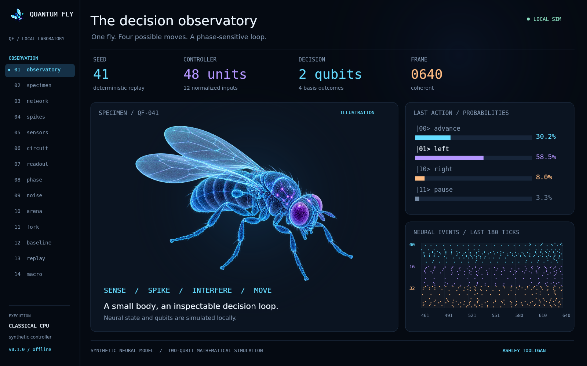

## 02 · specimen

The original holographic fly with the synthetic body's record.

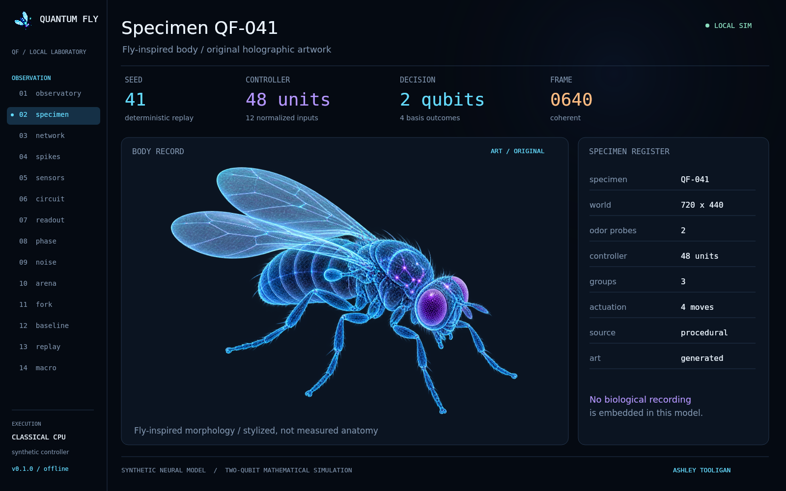

## 03 · network

Seeded network wiring and current smoothed activity for all 48 units.

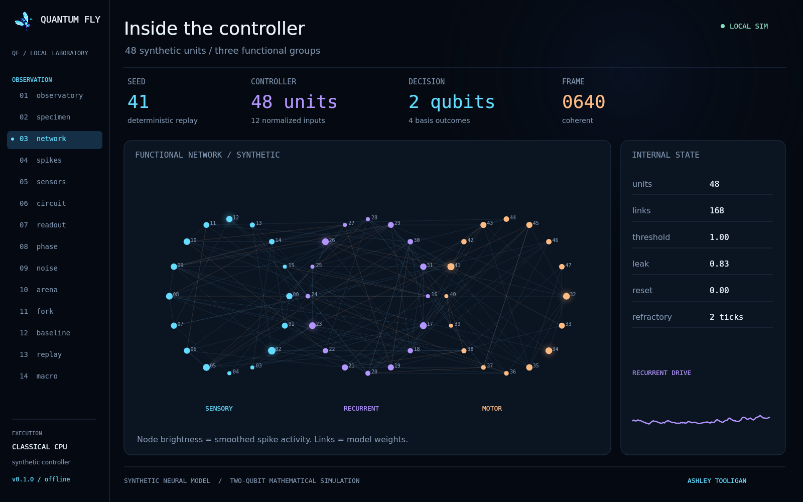

## 04 · spikes

The last 180 ticks of events and group activity.

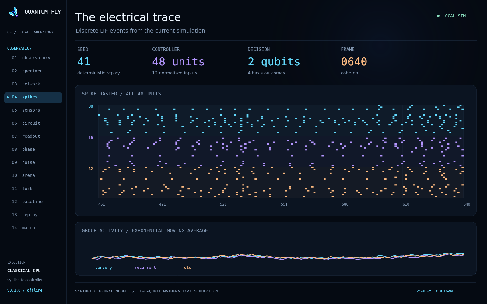

## 05 · sensors

Twelve input values and the arena from which they were sensed.

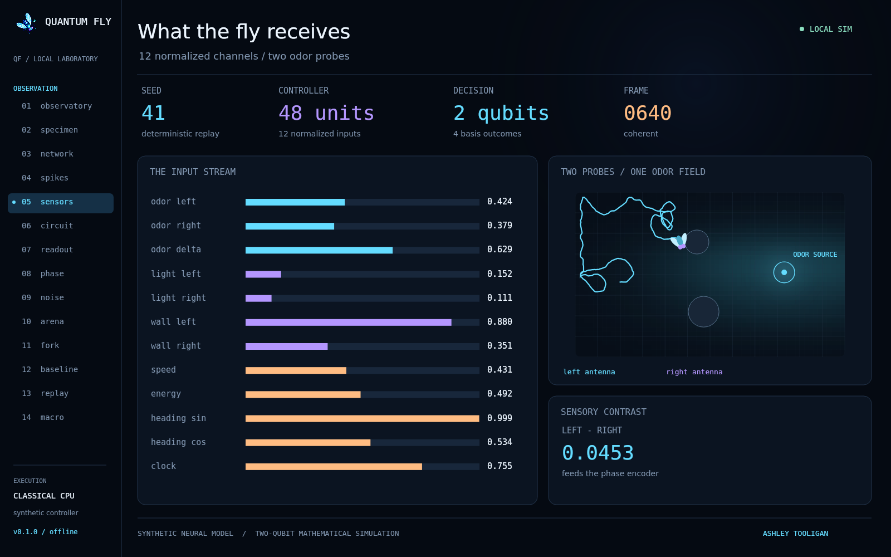

## 06 · circuit

The gate sequence and encoded numerical parameters.

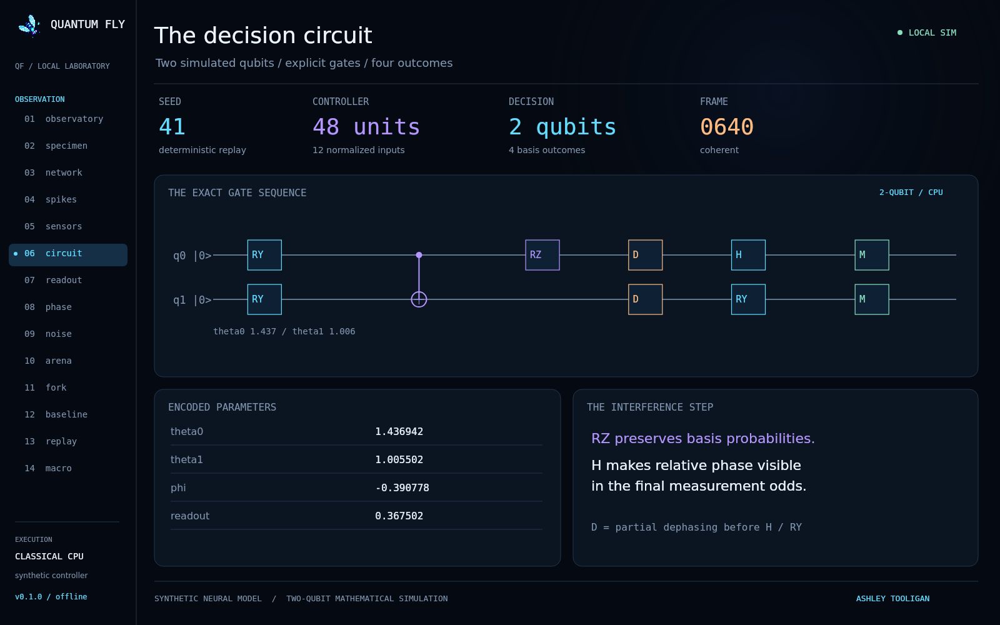

## 07 · readout

The four output probabilities, selected draw, and density diagnostics.

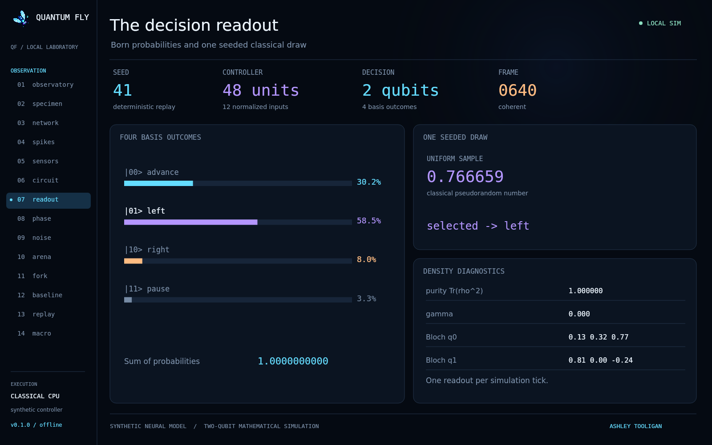

## 08 · phase

Frozen-input phase sweep across 65 parameter values.

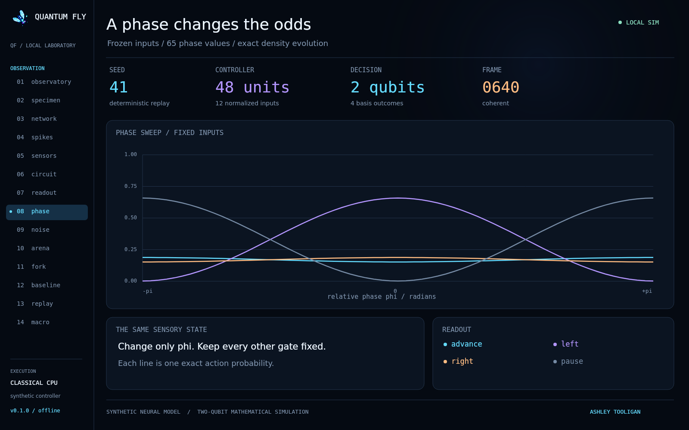

## 09 · noise

Partial dephasing sweep and final-state purity.

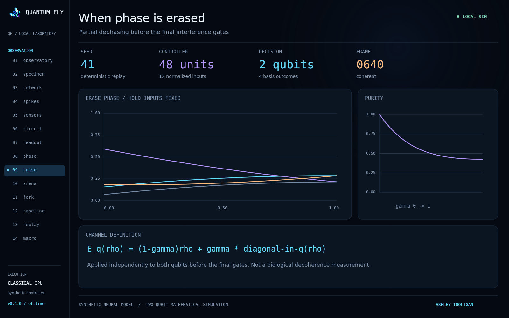

## 10 · arena

The trajectory, odor field, obstacles, and body telemetry.

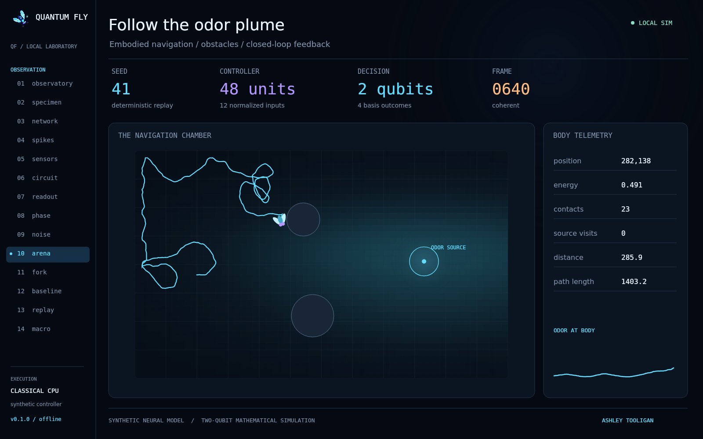

## 11 · fork

Matched initial state and draws with phase offsets 0 and +π/2.

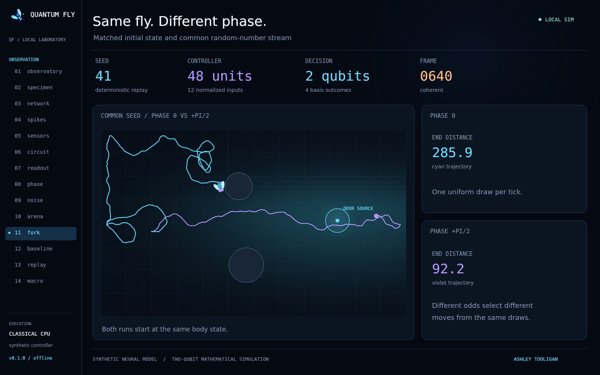

## 12 · baseline

Three declared policies compared at seed 41 after 640 ticks.

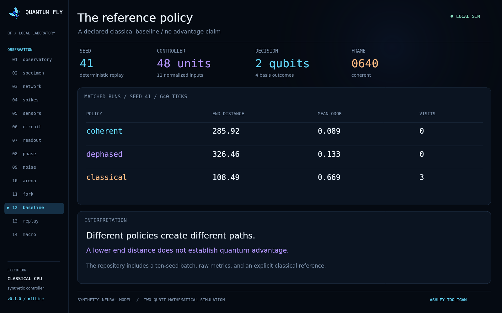

## 13 · replay

The last eight decisions and saved checkpoint fields.

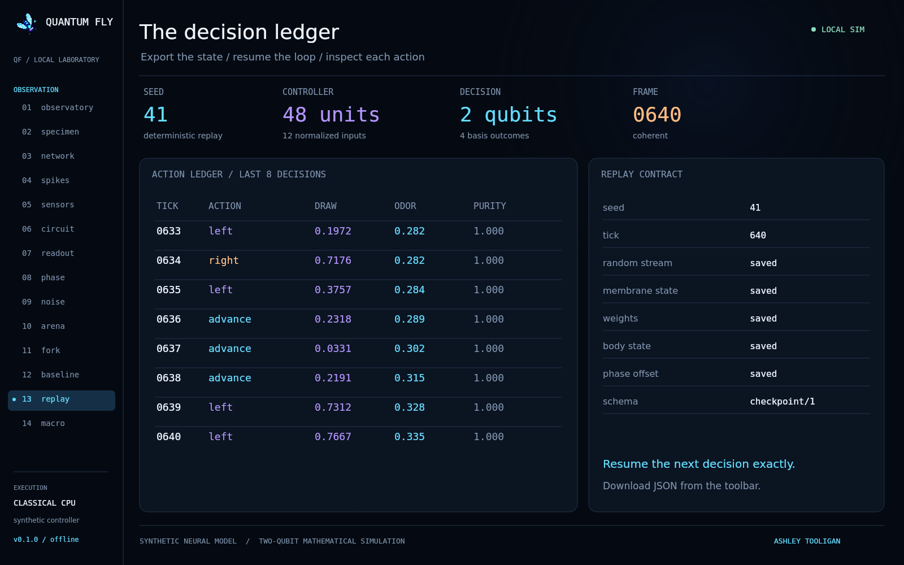

## 14 · macro

An original macro fly illustration in the observation interface.

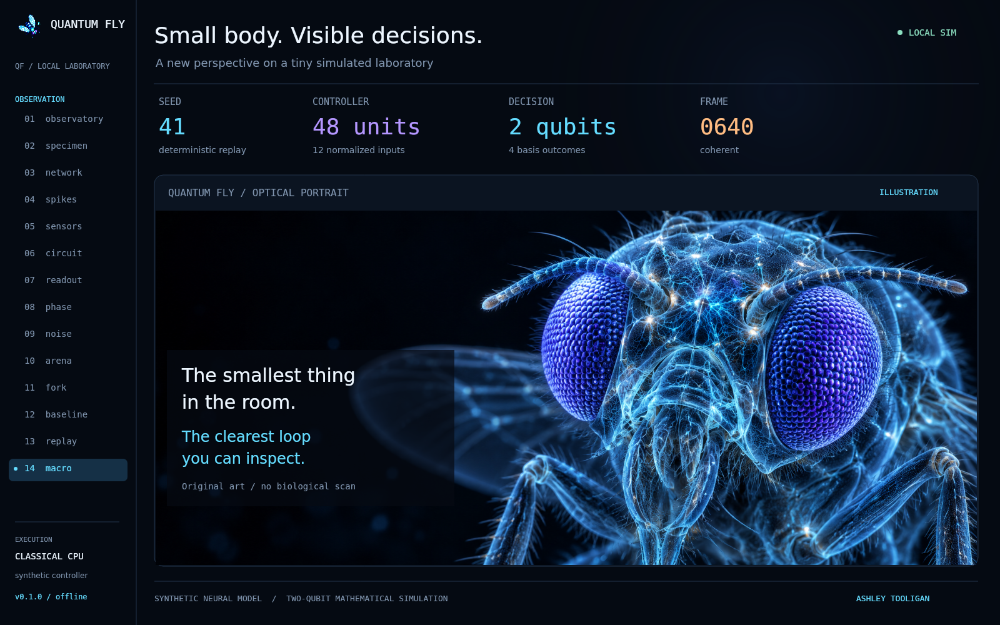

